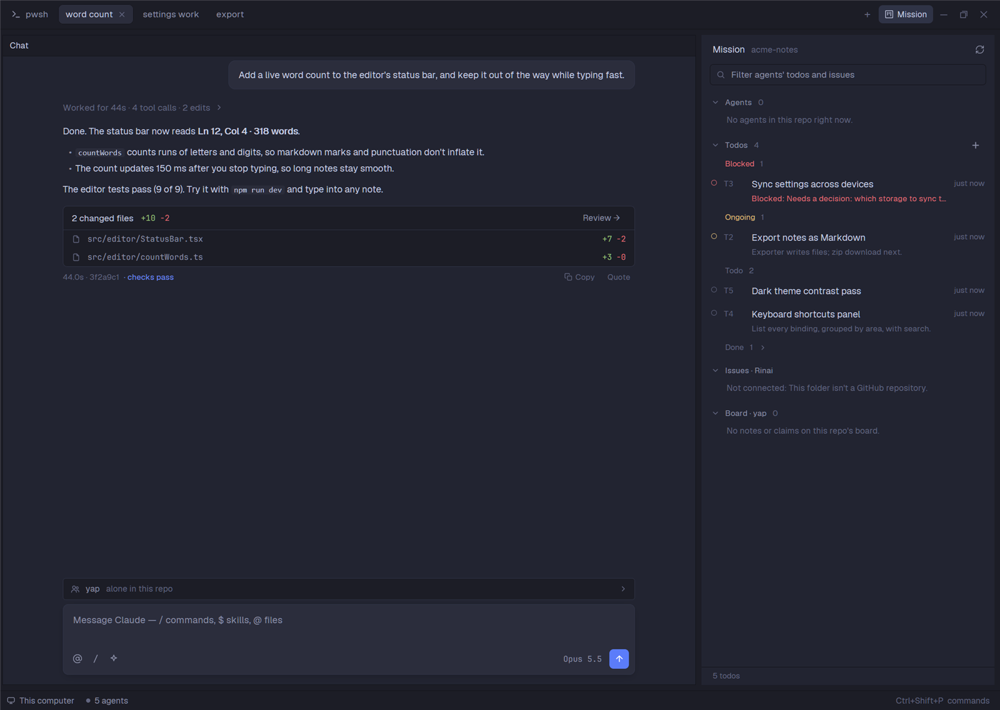
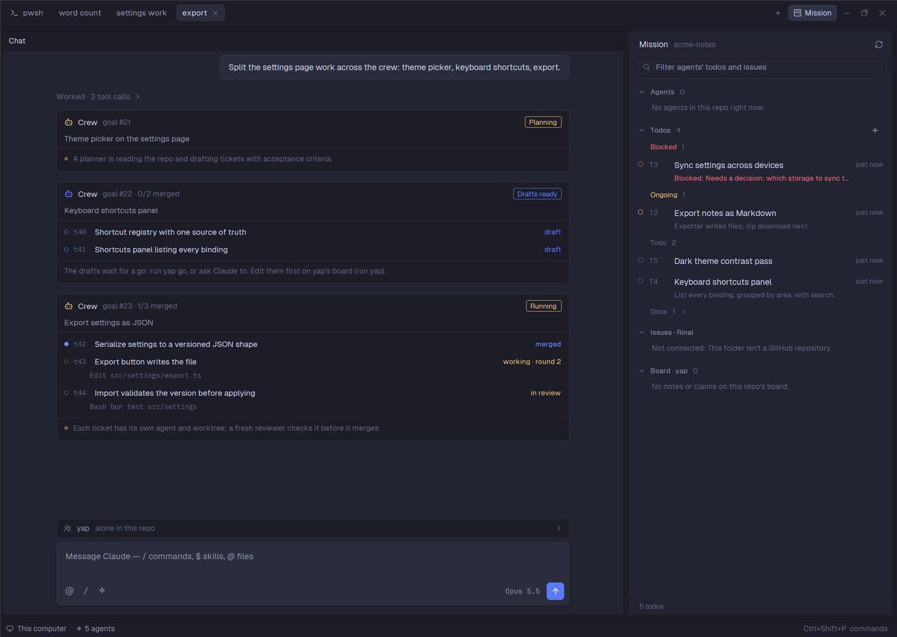

# Kodr for Herdr

Kodr turns Herdr's Claude Code panes into a workbench. Each Claude keeps its real terminal, and
**Terminal | Chat** in the pane header switches the same session to a structured chat. Around that, Kodr adds what an
agent's work needs before you trust it:



- **Chat**: your message, then one "Worked for 1m 32s · 6 tool calls" line per turn holding the narration, thinking and
  tool calls, then the answer and a changed-files card. Permission asks, questions and plans are cards you answer in
  the chat or the terminal. `/` commands, `$` skills, `@` files, pasted images, pictures a tool brought back, Ctrl+F.
- **Checkpoints**: every turn ends with a git checkpoint (`refs/kodr/checkpoints/…`), so you can see what each turn did.
- **Checks the agent can't edit**: with `.kodr/checks.json` in the repo, Kodr runs your checks after each turn from the
  base commit's copy of the test files, so editing a test can't make it pass.
- **Review**: a queue of turns to read, with their diffs and check results.
- **Mission**: the repo you're in at a glance: its agents (what each is doing, tasks done), and a todo board your
  agents keep themselves (they're told how when they start; you can add, move and delete too, or start a Claude on
  one), questions agents asked you with Reply, and the yap board when [yap](https://github.com/noxire-dev/yap) runs. Needs nothing but Node. With [Rinai](https://github.com/noxire-dev/gh-rinai) installed, the repo's issues show
  below: start an agent on a card in its own worktree, have a read-only Claude review the branch, send the findings
  back (review rounds), open the PR and squash-merge it, optionally all by itself.
- **The crew** (with yap): when work splits, the chat's Claude hands the goal to yap's crew. A planner drafts tickets,
  an agent works each one in its own worktree, a fresh reviewer checks it, and merges pass your gate. The goal shows
  in the chat as one live card with each ticket's round and current step, and ends with the crew's report.
- **Preview**: the dev servers running in your terminals, one key to open them.
- **Browser pane**: a browser inside herdr, with tabs, beside your terminal. `Ctrl+Shift+I` opens one, and so does
  Ctrl-clicking a `localhost` link. Kodr's Claude drives it with built-in tools (`read_page` at about a third of
  Playwright's tokens, click, type, tabs): its first browser call opens the pane, and you watch every tab it opens.
  Playwright `connectOverCDP` works too.
- **Sessions come back**: when Herdr loses its terminals (a reboot, a core update), it brings them back as plain shells.
  Kodr resumes the Claude that was running in each one when Herdr starts.
- **Notifications** (Windows): a desktop toast when a Claude needs you or finishes while you're elsewhere, per space.



Node only (plus one PowerShell script for the Windows notifications).

## Status

Early. Built and used daily on **Windows**; macOS is meant to work but hasn't been run yet. Desktop notifications are
Windows-only. Bug reports with `herdr-app status` output are welcome.

## Needs

- Herdr: `herdr-app` and `herdr-core` (`hc`) on your PATH. Built against herdr-app 0.1.16, hc 0.1.21.
- [Claude Code](https://claude.com/claude-code) (`claude` on your PATH) and git.
- Node 18 or newer (tested on 24).
- Optional:
  - `gh` with [gh-rinai](https://github.com/noxire-dev/gh-rinai) for Mission's board, PRs and merges;
  - [yap](https://github.com/noxire-dev/yap), so the chat shows messages between sessions, and the chat's Claude can hand a
    goal to yap's crew (agents per ticket, review, merge), shown as a live card with the crew's report;
  - Edge or Chrome, for the Browser pane (a page inside herdr that agents can drive over CDP). Windows always has Edge.
    Claude's browser tools need Node 22 or newer.

## Install

```sh
git clone https://github.com/noxire-dev/kodr-herdr
cd kodr-herdr
node bin/install.mjs
```

It copies Kodr's mods, a theme and the `kodr` layout into Herdr's home (`~/.config/herdr-app`, or `HERDR_APP_HOME`). It
also adds **Claude (Kodr)** to Herdr's new-agent menu, and binds Kodr's keys where they're free in the `kodr` layout.
Your own layouts and keys are left alone. Run it again after `git pull`.

Kodr's Claude Code hooks are loaded only by sessions started as **Claude (Kodr)**:
`claude --settings ~/.kodr-herdr/claude-settings.json`. To have every Claude in Herdr use them instead, run
`node bin/install.mjs --global`. That backs up `~/.claude/settings.json` first, and `--local` takes the hooks back
out. The hooks do nothing outside a Herdr terminal.

To remove Kodr, run `node bin/install.mjs --uninstall`. It takes Kodr's hooks out of `~/.claude/settings.json` (backed
up first), and its mods, theme, layout, menu entry and keys out of Herdr. Your own entries stay. Kodr's state in
`~/.kodr-herdr` stays too; delete that folder yourself.

The `kodr/` folder in this repo is the layout as herdr.dev shares it (layouts, mods, keys, theme, `RECIPE.md`,
`preview.png`). Its mods still need the Node side above: install with `node bin/install.mjs`, not by copying the folder.

## Use

Switch to the `kodr` layout, start **Claude (Kodr)** from `+`, and press `Ctrl+Shift+J` to flip between the terminal
and the chat.

| Key (kodr layout) | What it does |
|---|---|
| `Ctrl+Shift+J` | Terminal ⇄ Chat for this Claude |
| `Ctrl+Shift+M` | Permission mode, chat options, this space's notifications |
| `Ctrl+F` (in a chat) | Find in the chat |
| `Ctrl+Shift+R` | Review this session's turns |
| `Ctrl+Shift+G` | Mission |
| `Ctrl+Shift+H` | Past sessions, to resume one |
| `Ctrl+Shift+U` | Preview |
| `Ctrl+Shift+I` | Browser pane beside this one |

Checks, in `.kodr/checks.json` at the repo root:

```json
{ "setup": "npm ci", "pin": ["test/**", "**/*.test.js"], "checks": [{ "name": "test", "run": "npm test" }] }
```

`pin` lists the files restored to the base commit's version before the checks run.

Mission's per-repo settings (the gear) are a setup command for new worktrees, an accept command after Done, review
rounds, and auto-merge (off by default). They live in `~/.kodr-herdr/repos.json`, on this machine only.

Every feature in detail, with command names for scripts and keys, is in [docs/reference.md](docs/reference.md).

## What Kodr writes where

- `~/.kodr-herdr/`: per-terminal state (`t/<terminal>/`), `config.json`, `repos.json` and `mission.log`.
- `~/.herdr-browser/`: the Browser pane's Chromium profile (`profile/`) and `config.json`.
- `~/.config/herdr-app/mods/herdr-browser-frames/`: the Browser pane's recent frames (up to 40 files per open pane, removed when it closes).
- `~/.kodr-herdr/mcp.json`: the `herdr-browser` MCP server Kodr's Claude starts with.
- Herdr's home: the mods, theme, layout, a `programs.json` entry and key bindings.
- Your repos: checkpoint refs under `refs/kodr/`, and Mission's worktrees under Herdr's worktree folder.
- `~/.claude/settings.json`: only with `--global`, backed up first.

Nothing leaves your machine except what Claude Code, `gh` and git already send.

## Develop

[AGENTS.md](AGENTS.md) has how to try a change without touching your own setup, the self-checks, and what a change
must cover. The self-checks:

```sh
node lib/checkpoint.mjs && node lib/verify.mjs && node lib/tasks.mjs && node feed/kodr-feed.mjs --self-check \
  && node feed/kodr-mission.mjs --self-check && node feed/kodr-ports.mjs --self-check && node feed/kodr-yap.mjs --self-check && node feed/kodr-crew.mjs --self-check \
  && node hooks/kodr-hook.check.mjs && node mod/kodr-chat/blocks.check.mjs && node mod/kodr-chat/turns.check.mjs \
  && node mod/kodr-mission/board.check.mjs && node mod/kodr-pane/attention.check.mjs
```

## License

MIT
