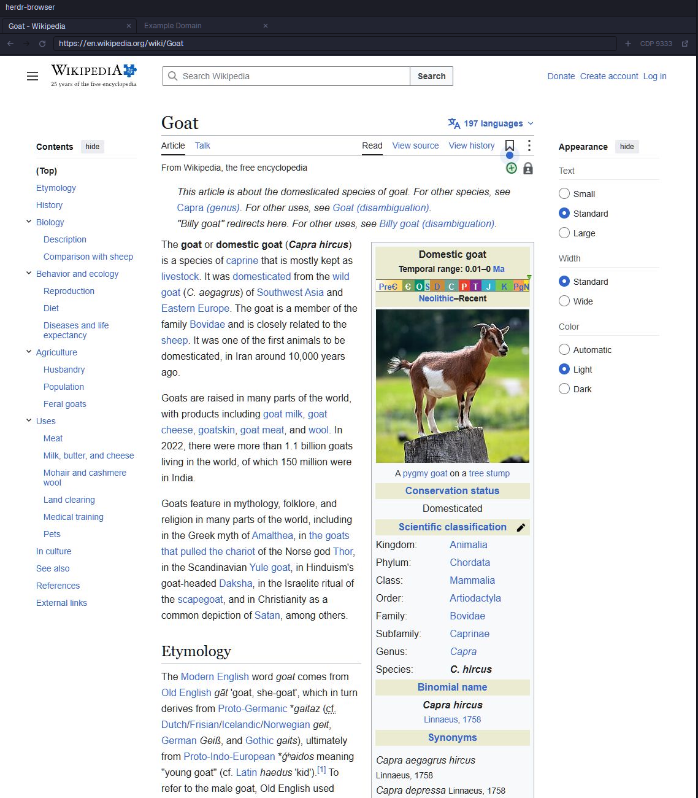

# herdr-browser

A browser pane for [herdr](https://herdr.dev)'s desktop app, beside your terminals, that your coding agents can drive.
Open `localhost:3000` next to the agent building it, and watch it click through the page.



- **A real page in a pane**: back, forward, reload, an address bar (a URL, a bare port like `3000`, or words to search),
  and tabs: Ctrl+T, Ctrl+W, Ctrl+Tab, or the strip's **+** and ×. Clicks, drags, the wheel, keys and the clipboard work.
- **Agents drive it** through the `herdr-browser` MCP server: `read_page` (the page's text plus a numbered list of
  what you can click or type into, about a third of the tokens of Playwright MCP's snapshot), `click`, `type`,
  `scroll`, `navigate`, `switch_tab`, `list_tabs`, `close_tabs` and `screenshot`. An agent's first call opens a pane
  beside you if none is open, and you see every tab it opens.
- **Its own browser**: a headless Edge or Chrome with its own profile, so your real browser and its logins are never
  touched. Playwright's `chromium.connectOverCDP("http://127.0.0.1:9333")` reaches the same tabs.

## Status

Early. Used daily on Windows with herdr-app 0.1.18; macOS and Linux are meant to work but haven't been run yet. The
same pane ships inside [Kodr](https://github.com/noxire-dev/kodr-herdr).

## Needs

- herdr's desktop app (`herdr-app`).
- Node 22 or newer.
- Edge or Chrome (Windows always has Edge). `HERDR_BROWSER` picks another Chromium.
- Optional: [Claude Code](https://claude.com/claude-code), which the installer registers the MCP server with.

## Install

```sh
git clone https://github.com/noxire-dev/herdr-browser
cd herdr-browser
node install.mjs
```

It copies the `herdr-browser` mod into herdr-app's home (`~/.config/herdr-app`, or `HERDR_APP_HOME`), writes
`~/.herdr-browser/config.json`, and adds the `herdr-browser` MCP server to Claude Code (user scope). Restart running
Claude sessions to get the tools; `--no-mcp` skips that. Run it again after `git pull`. `node install.mjs --uninstall`
takes it all out except the browser profile.

Any other MCP client:

```json
{ "mcpServers": { "herdr-browser": { "command": "node", "args": ["/path/to/herdr-browser/browser.mjs", "--mcp"] } } }
```

## Open one

- Ask your agent to open a page: its first browser call opens a pane beside the focused one.
- Ctrl-click (Cmd on macOS) a `localhost` or `127.0.0.1` link in a terminal, once your layout lets the mod take those
  links. Add it to the layout's `link_handlers` in `~/.config/herdr-app/layouts/<layout>.json`:
  `"link_handlers": ["herdr-browser"]`. Other links still go to your normal browser.
- From a script: `herdr-app do pane.split '{"direction":"right","mod":"herdr-browser","props":{"url":"http://localhost:3000","key":"any"}}'`

Each pane is one window of the browser, and its tabs are that window's pages. The pane shows whichever tab you or an
agent switched to last. Closing the pane closes its tabs; its tabs come back after a herdr restart.

## Limits

herdr's mods can't embed a webview yet, so the pane draws the browser's screencast as images. That means:

- About 4 frames a second on a busy page, and on pages that animate a lot the picture can blank for a moment (herdr
  drops images under memory pressure).
- No IME, file pickers or downloads.
- There's no approval step: an agent can click anything on any site it opens. The profile has none of your logins;
  keep it that way.

## What it writes where

- `~/.herdr-browser/`: `config.json` (where Node and this folder are) and `profile/` (the browser's profile).
- `~/.config/herdr-app/mods/herdr-browser/`: the mod. `mods/herdr-browser-frames/`: recent frames (up to 40 files per
  open pane, removed when it closes).
- Claude Code's user MCP config: the `herdr-browser` entry.

## Develop

`node browser.mjs --self-check && node tools.check.mjs && node mod/herdr-browser/input.check.mjs`, and
`herdr-app check mod/herdr-browser`. [AGENTS.md](AGENTS.md) has the rest.

## License

MIT
