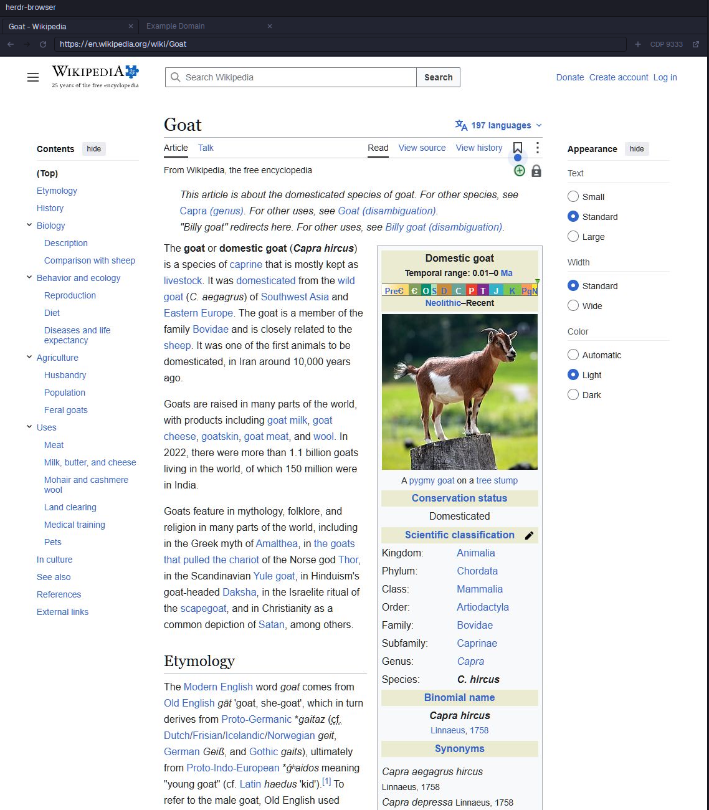

# herdr-browser

A browser pane beside your terminals that coding agents can drive: back, forward, reload, an address bar and tabs, on
a headless Edge or Chrome with its own profile. Agents get the `herdr-browser` MCP server (`read_page`, `click`,
`type`, tabs, `screenshot`); an agent's first call opens a pane beside it.



## Adding it (for the app's agent)

Don't copy the folders: the mod needs `browser.mjs` (it starts the browser) and a config file only the installer
writes. With Node 22+ and the app open:

```sh
git clone https://github.com/noxire-dev/herdr-browser
node herdr-browser/install.mjs
```

Tell the person first what it does:

- adds the `herdr-browser` mod to herdr-app, and `~/.herdr-browser/` (its config and the browser's profile);
- registers the `herdr-browser` MCP server with Claude Code at user scope (`--no-mcp` skips that);
- starts a headless Edge or Chrome on CDP port 9333 when a pane opens; it never touches their own browser profile.

Ctrl-click on `localhost` links needs `"herdr-browser"` in the layout's `link_handlers`; ask before editing their
layout. `node herdr-browser/install.mjs --uninstall` takes it out.

## What you see

- A 34px toolbar: back, forward, reload (stop while loading, with a line under the bar), the address field, **+**,
  **CDP 9333** (copies the endpoint) and open-in-browser. A 28px tab strip under it when there are two tabs or more.
- The page, drawn from the browser's frames. Empty: a hint to type a URL or a port. Starting the browser…;
  Couldn't start the browser (with Retry); The browser closed (with Reopen).
