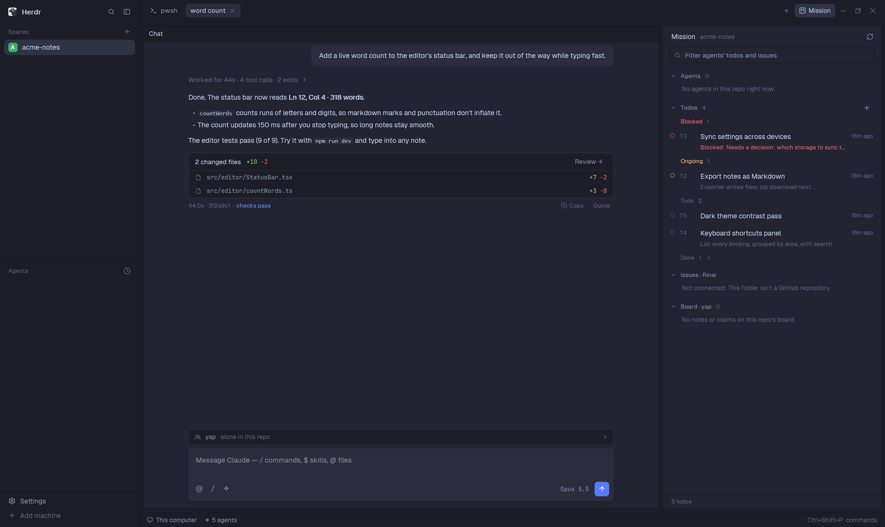

# Kodr

A workbench for Claude Code in Herdr. Every Claude keeps its real terminal, and a **Terminal | Chat** switch in
the pane header flips the same session to a structured chat. A turn reads as your message, then one "Worked for 44s ·
4 tool calls · 2 edits" line holding the work, then the answer, then a changed-files card with the turn's git
checkpoint and check results. A side panel, **Mission**, shows the repo you're in: its agents, a todo board the agents
keep themselves, questions they asked you, and the Rinai issues when Rinai is installed. Dark, Zed-like, quiet.

## What you see

Left to right, on a `#1c1d26` canvas with 1px `#131319` dividers and no system title bar (traffic lights at 12,16):

- **Sidebar, 268px** (min 44, max 480, not resizable), background `chrome` `#1c1d26`, top to bottom:
  - A 46px brand row (shipped `workspace-chrome`, drags the window).
  - **Spaces** (shipped `spaces`).
  - **Agents** (`kodr-agents`), the two lists sharing the height 1:1 (min 90 each). It is Herdr's agents list plus
    a second line under each agent: the task its Claude has in progress, else its `yap doing` line, with "2/5"
    for how far through its task list it is.
  - A 69px footer (shipped `workspace-chrome` with `footer: true`): Settings and Add machine.
- **Work column**:
  - A 42px **tab bar** (`kodr-tabs`): Herdr's tabs plus a **Mission** button at the right, before the window
    buttons.
  - The **body**, 8px padding and 8px gap. It holds the active tab's panes, background `#222431`, a 1px `#131319`
    border, square corners, no gap between panes. Each pane has a 30px **header** (`kodr-pane`, always shown): the
    program's icon and name, a **Terminal | Chat** segmented switch (20px tall, 11.5px text; the current side filled
    `#2f3346`), the folder in `#61657f`, then the status. Working is a spinning 12px circle in `#e5c07b`. Blocked is a
    "Needs you" chip in `#e06c75` on a 15% tint. Done is a 6px `#6f8cf7` square. Split, zoom and close icons show on
    hover.
  - A **side panel**, 420px (min 280, max 900), hidden until asked for. It is a stack of shipped `files`, shipped
    `changes` and **Mission** (`kodr-mission`).
  - A 28px **status bar** (shipped `workspace-status`).
- **The chat** (`kodr-chat`, opened by the switch, zoomed over its terminal) is a centered column, 820px at most:
  - Your messages are right-aligned bubbles on `#2b2d3c`, up to 620px wide.
  - The work line is muted `#61657f` with a chevron; the answer is markdown in `#c8cee6`.
  - The changed-files card lists each file with green/red line counts. Under it, in `#61657f`: the turn time,
    the checkpoint sha, and "checks pass" in `#5b7cfa` (or failing in `#e06c75`), with Copy and Quote at the right.
  - At the bottom: a yap strip (who else works in the repo), then the composer with `@ / $` buttons, the
    permission mode, the model in mono, and a `#5b7cfa` send button.
- **Mission** (13px type, 42px header "Mission · <repo>" with a refresh icon) runs top to bottom:
  - a filter field;
  - **Needs you** (questions agents asked you, each with Reply);
  - **Agents** (status dot, stage, tasks done/total);
  - **Todos**, grouped Blocked (`#e06c75` label), Ongoing (`#e5c07b`), Todo, then Done folded, each row "T3 · title ·
    age" with its latest note under it;
  - **Issues · Rinai**;
  - **Board · yap** (notes and claims).

  The footer says "5 todos".
- Theme `kodr-zed`. The colors used above are `#222431` background, `#c8cee6` text, `#8b8fa7` muted, `#61657f` dim,
  `#5b7cfa` accent, `#2a2c3a` hover, `#2f3346` selected, and the four status colors.

## How it behaves

- **Agent status everywhere** uses one set of colors: working `#e5c07b`, blocked `#e06c75` ("Needs you"), done
  `#6f8cf7`, idle `#61657f` (a ring). Blocked rises to the top of the Agents list.
- **Terminal | Chat** shows only while a Claude runs in the pane.
  - Chat splits a chat pane beside the terminal, zooms it and focuses it; the terminal keeps its pane, so the agent
    stays in Herdr's Agents list. Terminal (or the chat's ×) closes the chat.
  - `Ctrl+Shift+J` does the same for the focused pane.
- **In the chat**:
  - Enter sends, or steers or queues while Claude works, as the composer's Queue | Steer switch says; Ctrl+Enter
    does the other.
  - Permission asks, questions and plans are cards; answering in the chat or in the terminal both count.
  - Scrolled up, the chat stays put and offers Jump to latest.
  - Ctrl+F finds in the chat ("2 of 5").
  - `Ctrl+Shift+M` opens the permission mode menu and the chat options, including this space's notifications
    (All / Needs me / Off).
  - A goal the chat's Claude hands to yap's crew (`yap goal`) becomes a live card with its tickets and, at the
    end, the crew's report.
- **Mission** opens with the tab bar's Mission button or `Ctrl+Shift+G` (it shows the panel's `mission` child).
  - A todo opens in the panel with Start (a Claude in a new tab, told to work it), Move and Delete.
  - With Rinai, a card can start an agent in its own worktree, run a read-only review, send findings back (review
    rounds), open the PR and squash-merge it.
- **Other keys** (bound under `layout:kodr` only where free):
  - `Ctrl+Shift+R`: the review queue for this session.
  - `Ctrl+Shift+H`: past sessions to resume.
  - `Ctrl+Shift+U`: Preview, the dev servers in your terminals.
- New chat rows fade in over 220ms. Running items pulse their dot's opacity on a 1.2s loop.

## Built from

- **Layout `kodr`** (cloned from `main` 0.1.16):
  `row[ column sidebar(268px)[ block brand(workspace-chrome, 46px), column[ block spaces(spaces), block agents(kodr-agents) ], block footer(workspace-chrome {footer:true}, 69px) ], column work[ block tabs(kodr-tabs, 42px), row work-body(padding 8, gap 8)[ block main(tab: active, pane header kodr-pane 30px always, border 1 border, radius 0, gap 0, lone), column panel(420px, hidden)[ stack panel-body[ files, changes, mission(kodr-mission) ] ] ], block status(workspace-status, 28px) ] ]`.
  Background `canvas`, `terminal_padding` [12, 8], divider 1px `border`, `titlebar: none`.
- **Kodr's mods**:
  - `kodr-tabs` and `kodr-agents` are copies of the shipped `tabs` and `agents` with small additions (marked
    "Kodr:").
  - `kodr-pane` is the pane header, with props `{pane, terminal}`.
  - `kodr-chat` is the chat, with props `{terminal}`, opened through `pane.split {mod}`.
  - `kodr-mission` is the side panel.
  - `kodr-review`, `kodr-preview` and `kodr-sessions` are overlays and a tab.
- **Shipped mods used**: `workspace-chrome`, `spaces`, `files`, `changes`, `workspace-status`.
- **`herdr` functions**: `panes`, `terminals`, `agents`, `spaces`, `props`, `theme`, `exec`, `hc`, `run`,
  `readTextFile`, `notify`, `nextCommand`, `shared` / `setShared`, `image`.
- **Commands it runs**: `pane.split`, `pane.zoom`, `pane.focus`, `pane.close`, `terminal.keep`, `agent.focus`,
  `tab.new`, `space.new`, `space.select`, `layout.select`, `mod.open`.
- **Programs**: every data source is a Node script (`feed/*.mjs`) from github.com/noxire-dev/kodr-herdr, found
  through `~/.kodr-herdr/config.json`. Kodr's Claude Code hooks (`hooks/kodr-hook.mjs`) record each session,
  checkpoint each turn and run the checks. The mods also run `hc`, `git`, `gh` (Mission with Rinai), `claude` and
  `herdr-app`. On Windows they run `powershell` for notifications.
- **Art**: Lucide-style 24px stroke SVGs, 1.5 stroke, in each mod folder.

## Watch out

- **The mods need Kodr's Node side.** Copying this folder gives you the layout and its mods, but the chat,
  Mission, the agents' stage lines and Preview read their data from Kodr's scripts. Clone
  github.com/noxire-dev/kodr-herdr and run `node bin/install.mjs` (it also installs these files). Without it,
  Mission and the Chat switch say "Kodr's tools aren't installed".
- **Hooks.** The switch shows for any running Claude, but permission cards, checkpoints and checks need Kodr's
  hooks. The hooks load only in sessions started as **Claude (Kodr)**, unless you install with `--global`.
- **Re-copy on Herdr updates.** `kodr-tabs` and `kodr-agents` are copies of shipped mods: re-copy them when Herdr
  updates `tabs` or `agents`, then reapply the "Kodr:" parts.
- **Don't name a mod's state field after a method.** The chat view's state shares `this` with its methods, so a field
  named like one (`reply`) breaks render with "not a function".
- **Line height** in GPUI is a multiplier when given a bare number: use px (20px in the thread).
- **Transitions.** Drive row fade-ins from the view, not GPUI's `transition`: with `transition`, a new row stayed at
  opacity 0.
- **Platforms.** Built on Windows; macOS is untested. Desktop notifications are Windows-only. Mission's review,
  PR and merge need `gh` with gh-rinai; the crew needs yap.

## Done when

1. `herdr-app check mods/<name>` passes for each of the eight `kodr-*` mods, and `layout.switch {"name": "kodr"}`
   shows the sidebar, tab bar with Mission, pane headers and status bar as in the preview.
2. In a pane running Claude (Kodr), the header shows Terminal | Chat. Chat opens the chat zoomed with the session's
   turns. Terminal closes it, and the agent stays in the Agents list throughout.
3. A turn that edits files ends with a changed-files card showing a checkpoint sha. With `.kodr/checks.json` in the
   repo, the card shows "checks pass" or "checks fail".
4. `Ctrl+Shift+G` opens Mission on the space's repo. `node feed/kodr-todo.mjs add "x"` run there shows up under
   Todos within 5s.
5. A pane whose Claude has exited back to the shell no longer offers Terminal | Chat.
